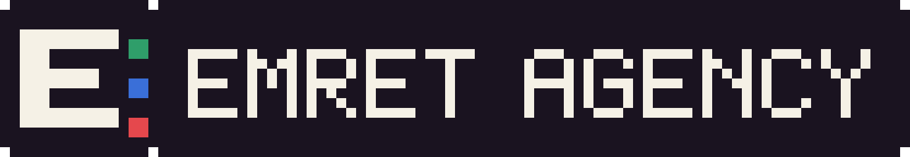
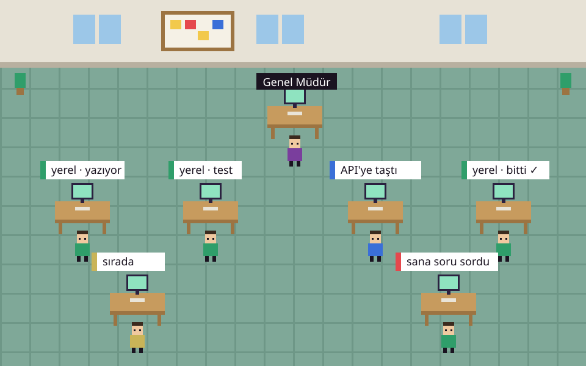
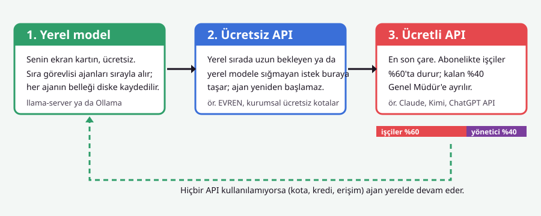

<p align="right"><a href="README.md"><b>🇹🇷 Türkçe</b></a> | <b>🇬🇧 English</b></p>

<p></p>

# Emret Agency

**An autonomous AI agent office running on your local machine.** General Manager decomposes roadmaps and delegates work; specialized worker agents write code at pixel desks. As much work as possible is executed on your local GPU with zero token fees.



[Setup Guide](docs/SETUP.md) ·
[Ollama Local Model Guide](docs/OLLAMA-SETUP.md) ·
[Visual Setup Guide (Web)](docs/kurulum.html) ·
[Website](https://emret-agency.github.io/emret-agency/) ·
[Sponsor](#support)

## What's Inside

- **Multi-Agent CLI Orchestration** — Claude Code, OpenCode, Codex, Crush, pi, and your favourite CLI agents in one unified hub.
- **Local Model Priority** — llama-server or Ollama on your graphics card. Local first, free cloud APIs second, paid APIs last.
- **Slot Cache Agent Memory** — When turns switch, agent context is saved to disk; resuming a 51k-token conversation takes ~2s instead of ~30s.
- **Quota Safeguard (60% / 40%)** — On Claude subscriptions, workers halt Claude usage at 60% and fall back to local models; 40% remains reserved for the General Manager.
- **Checkpoint Notes** — Each agent maintains a compact `devam.md` summary to resume immediately after reboots.
- **Ask Me & Review Desk** — Architectural questions, risk approvals, and git pull request diffs grouped with red badge alerts.
- **Multi-Project Isolation, Telegram Bot, Themes & Office Layout Customizer.**



## Quick Start (Windows)

**Run 100% free if you have an NVIDIA GPU (8 GB+ VRAM):**
First install [Ollama](https://ollama.com/download) (`winget install Ollama.Ollama`).
Agents run on your local hardware with zero token costs. If you do not have a dedicated GPU, skip Ollama and omit `-Yerel`; agents will run via your cloud API keys.

```bash
git clone https://github.com/emret-agency/emret-agency.git
cd emret-agency
kurulum.cmd -Yerel
baslat.cmd
```

`kurulum.cmd` validates required prerequisites (Node.js 20+, Python 3.12, C++ Build Tools, Ollama), compiles native modules, and pulls the recommended Gemma 4 12B model (`emrettc-genel`, ~8 GB).

For macOS / Linux and advanced configurations, see the [Full Setup Guide](docs/SETUP.md).

## Development & Packaging

```bash
npm run dev                    # Development mode
npm run typecheck              # TypeScript checks
node --test test/*.test.cjs    # Run test suites
npm run dist:win               # Build standalone Windows setup installer (.exe)
```

- Architecture: [docs/ARCHITECTURE.md](docs/ARCHITECTURE.md)
- BYOK Engines: [docs/BYOK-MOTORLAR.md](docs/BYOK-MOTORLAR.md)
- Contributing: [CONTRIBUTING.md](CONTRIBUTING.md)

## Support

Emret Agency is free and open-source under the MIT license. If you find it helpful, please consider supporting development:

[](https://donate.bynogame.com/emrettc)

## License

Source code is MIT licensed, see [LICENSE](LICENSE); pixel artwork licensed under [LICENSE-ASSETS](LICENSE-ASSETS).

