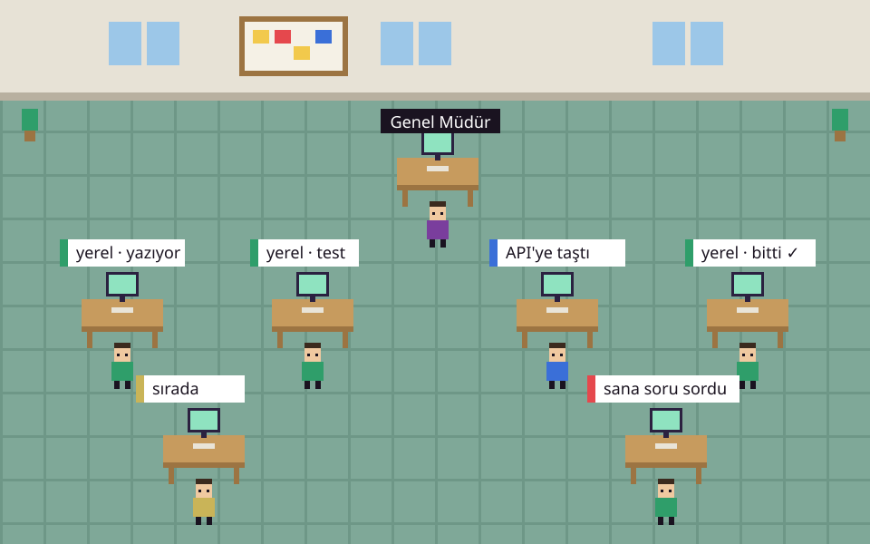
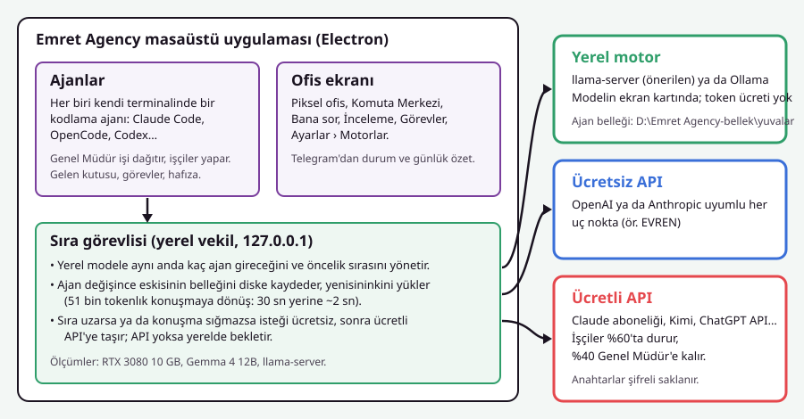

# Emret Agency


> **TR:** Kendi bilgisayarınızda çalışan, ücretsiz yerel modeller ve API‑ler ile çoklu kodlama ajanlarından oluşan bir ofisi yönetin.
> **EN:** Run a local office of multiple coding agents on your PC, with free local models and optional API integrations.

---

## 🎬 Live Demo
- **Landing page:** https://crewgamestudio.com/emretagency.html
- **Setup guide (HTML):** https://crewgamestudio.com/emretagency.html#kurulum

---

## 📸 Screenshots
| Feature | Screenshot |
|---------|------------|
| **Landing page** |  |
| **Architecture diagram** |  |
| **Setup wizard** |  |

---

## ✨ Features
- **Bilingual UI** – Switch between Turkish (TR) and English (EN) instantly.
- **Multiple agents** – Claude Code, OpenAI, Anthropic, Gemini, etc., all coordinated by a "General Manager".
- **Local model support** – Ollama integration; running models on your GPU without token costs.
- **Automatic dependency installer** – `kurulum.cmd` checks and installs Node, Git, Python, VS Build Tools, and Ollama.
- **Engine priority** – Local → Free API → Paid API (drag‑and‑drop order in Settings).
- **Telegram notifications** – Real‑time status updates and daily summaries.
- **Workspace isolation** – Each project has its own workspace folder, agent memories, and task logs.

---

## 🛠️ Installation (Windows)
```powershell
# 1️⃣ Clone the repository
git clone https://github.com/emrettc/emret-agency.git
cd emret-agency

# 2️⃣ Install required tools (Winget will handle most of them)
#   Node.js LTS, Git, Python 3.12, VS Build Tools, Ollama (optional)
#   You can run the installer script which does this automatically:
kurulum.cmd

# 3️⃣ (Optional) Install local model via Ollama
kurulum.cmd -Yerel
#   or install all models (~40 GB)
kurulum.cmd -Yerel -TumModeller

# 4️⃣ Start the application
baslat.cmd
```
The terminal window must stay open while the app runs. Open your browser at `http://localhost:3000` (or the port shown).

---

## ⚙️ Settings & API Configuration
1. **Agents & Models** – *Settings → Agents & Models → Engines*:
   - Choose the default worker engine (e.g., `emrettc‑genel`).
   - Drag‑and‑drop to set the engine priority order.
2. **API Keys** – Add keys for OpenAI, Anthropic, Gemini, etc., under *Settings → API Keys*.
3. **Ollama Model Files** – Located in `resources/ollama/`. Use `ollama create <name> -f <Modelfile>` to add custom models.
4. **Telegram** – Provide your bot token under *Settings → Telegram* for push notifications.

---

## 🤖 Using the Agents
| Agent | Typical command | Example |
|-------|----------------|---------|
| **General Manager** | Assign tasks | `Komuta Merkezi → “Create a new React project”` |
| **Developer** | Write/fix code | `Komuta Merkezi → “Refactor this function to TypeScript”` |
| **Designer** | UI suggestions | `Komuta Merkezi → “Suggest a modern button design”` |
| **Researcher** | Gather info | `Komuta Merkezi → “Summarize the latest React release notes”` |
| **Chatbot** | Q&A | `Bana sor → “What does npm ci do?”` |

---

## 📚 Documentation
- Turkish guide: `docs/KURULUM.md` (also available as `docs/kurulum.html`).
- English guide: `docs/SETUP.md` (and `docs/OLLAMA-SETUP.md`).

---

## 🤝 Contributing
1. Fork the repo.
2. Create a feature branch.
3. Run `npm run lint && npm run typecheck` before committing.
4. Submit a Pull Request.

---

## 📄 License
MIT – see the `LICENSE` file.
