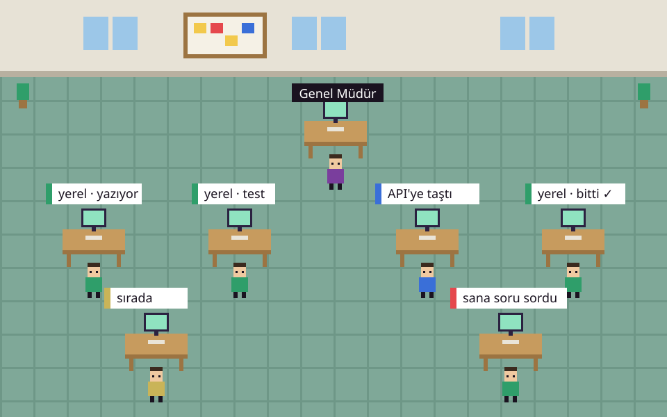
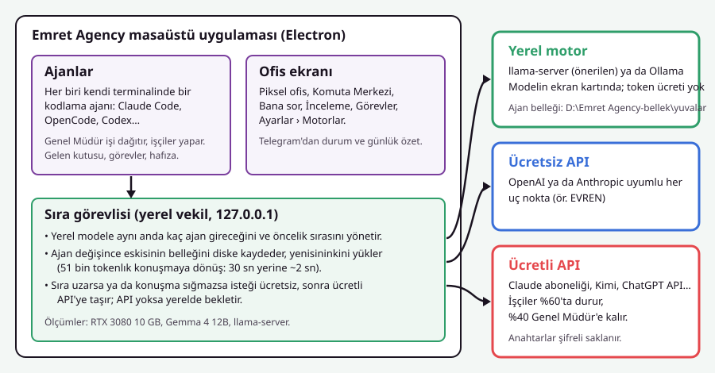
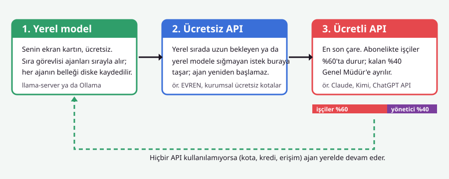
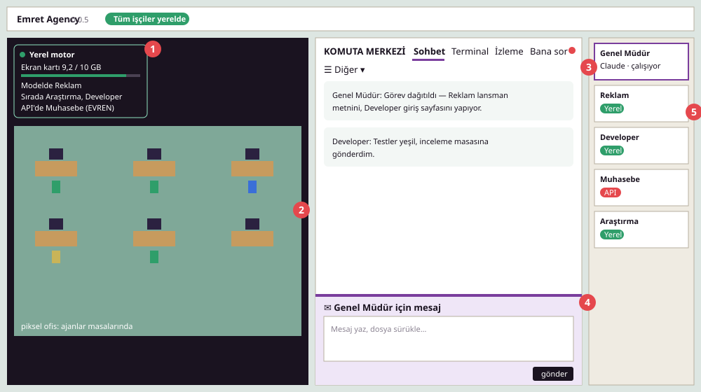

<p></p>

# Emret Agency — Kurulum ve Kullanım Kılavuzu



Emret Agency, kodlama ajanlarından oluşan bir ofisi tek pencereden yöneten bir masaüstü
uygulamasıdır. Her ajan kendi terminalinde çalışır; **Genel Müdür** işi dağıtır,
işçi ajanlar piksel ofiste masalarında çalışırken görünür. Ajanlar mümkün olduğunca
**senin bilgisayarındaki yerel modelle** çalışır; yerel yetmediğinde önce ücretsiz,
en son ücretli API'lere geçer.

- [Ne işe yarar?](#ne-işe-yarar)
- [Özellikler](#özellikler)
- [Gereksinimler](#gereksinimler)
- [Kurulum (Windows)](#kurulum-windows)
- [Yerel model (Ollama) kurulumu](#yerel-model-ollama-kurulumu)
- [Kurulum (macOS / Linux)](#kurulum-macos--linux)
- [İlk açılış](#ilk-açılış)
- [Motorlar: yerel ve API](#motorlar-yerel-ve-api)
- [Yerel motoru hızlandırma](#yerel-motoru-hızlandırma)
- [Ekran turu](#ekran-turu)
- [Telegram](#telegram)
- [Program olarak (.exe) paketleme](#program-olarak-exe-paketleme-ve-dağıtım)
- [Sorun giderme](#sorun-giderme)
- [Sık sorulanlar](#sık-sorulanlar)

---

## Ne işe yarar?

Tek bir kodlama ajanıyla çalışmak bir çalışanla çalışmak gibidir: ona iş verirsin,
bitene kadar beklersin. Emret Agency bunu bir ofise çevirir:

- **Genel Müdür** (yönetici ajan) senin isteğini görevlere böler ve işçilere dağıtır.
- **İşçiler** (Developer, Tasarım, Reklam, Araştırma…) görevlerini kendi çalışma
  klasörlerinde yapar, birbirlerine mesaj atar, bitince raporlar.
- Sen **Komuta Merkezi**'nden Genel Müdür'le konuşur, ajanların sorularını
  **Bana sor** sayfasında yanıtlar, işleri **İnceleme**'den birleştirirsin.

Amaç: ücretli token harcamadan, kendi donanımında, gece gündüz çalışan bir ekip.

## Özellikler

| Alan | Ne yapar |
| --- | --- |
| **Çoklu ajan** | Claude Code, OpenCode, Codex, Crush, pi ve diğer CLI ajanları aynı ofiste. |
| **Yerel model** | llama-server ya da Ollama ile ekran kartında; anahtar ve token ücreti yok. |
| **Ajan belleği** | Sıra başka ajana geçince ajanın okuduğu her şey diske kaydedilir, dönünce 1–2 sn'de yüklenir. |
| **Motor sırası** | Yerel → ücretsiz API → ücretli API. API kalmazsa yerelde devam. |
| **Kota koruması** | Ücretli abonelikte işçiler %60'ta durur, %40 Genel Müdür'e kalır. |
| **Devam noktası** | Her ajanın kısa `devam.md` notu: yeniden başlayınca geçmişi okumadan kaldığı yerden sürer. |
| **Bana sor** | Ajanların soruları ve onay isteyen işlemler tek sayfada; menüde kırmızı rozetle görünür. |
| **İnceleme masası** | Ajanların dallarını fark, test ve tek tıkla birleştirme/geri alma ile incelersin. |
| **Projeler** | Tek ofiste birden çok proje; proje başına görev ve harcama. |
| **Telegram** | Durum, günlük özet ve bildirimler telefonuna. |
| **Görünüm** | Hazır temalar, açık/koyu mod, logo, ofis düzenleyici (masaları sürükle-bırak). |



## Gereksinimler

| | En az | Önerilen |
| --- | --- | --- |
| İşletim sistemi | Windows 10/11, macOS 13+, Ubuntu 22.04+ | Windows 11 |
| Bellek (RAM) | 16 GB | 32–64 GB (ajan belleği RAM önbelleği için) |
| Ekran kartı (yerel model için) | 8 GB NVIDIA | 10–24 GB NVIDIA (RTX 3080 ve üstü) |
| Disk | 30 GB boş | Hızlı NVMe; ajan belleği için ayrı klasör |
| Yazılım | Node.js 20+, git | + Python 3.12, C++ derleme araçları |

En az bir **ajan CLI'ı** kurulu olmalı (yönetici için önerilen: `claude` — Claude Code).
Yerel model kullanmayacaksan ekran kartı gerekmez; ajanlar API ile çalışır.

## Kurulum (Windows)

> **Bilgisayarın iyiyse ücretsiz çalış.** Ekran kartın yeterliyse (NVIDIA, 8 GB ve
> üstü) önce [Ollama](https://ollama.com/download)'yı kur. Ajanlar senin bilgisayarındaki
> yerel motorla, token ücreti ve API anahtarı olmadan çalışır. Ekran kartın yoksa
> Ollama'yı atla; ajanlar bağladığın API motorlarıyla çalışır.
> Ayrıntı: [Yerel model (Ollama) kurulumu](#yerel-model-ollama-kurulumu).

1. **Depoyu indir**

   ```bash
   git clone https://github.com/emret-agency/emret-agency.git
   cd emret-agency
   ```

2. **Kurulum betiğini çalıştır.** Eksik bir şey varsa nasıl kurulacağını söyler
   (`winget install …` komutlarıyla), sonra paketleri kurar ve derler:

   ```bash
   kurulum.cmd
   ```

   Yerel modeli de kurmak için (Ollama kurulu olmalı):

   ```bash
   kurulum.cmd -Yerel
   ```

   Dört modelin hepsi için (~40 GB indirme): `kurulum.cmd -Yerel -TumModeller`

3. **Başlat**

   ```bash
   baslat.cmd
   ```

   Açılan siyah pencere uygulama açıkken açık kalmalı.

> **Elle kurulum** (betik kullanmadan): Python 3.12 ve Visual Studio Build Tools 2022
> ("C++ ile masaüstü geliştirme" + "MSVC Spectre korumalı kitaplıklar") kur, sonra
> `npm ci --ignore-scripts`, `node node_modules/electron/install.js`,
> `npm run postinstall`, `npm run dev`. Sistemde `NoDefaultCurrentDirectoryInExePath`
> ortam değişkeni tanımlıysa derleme sırasında kaldır.

## Yerel model (Ollama) kurulumu

Yerel motor ücretsizdir: model senin ekran kartında çalışır, token ve API anahtarı
gerekmez. Hangi modelin çalışacağı ekran kartının belleğine bağlıdır:

| Ekran kartı (NVIDIA) | Model | Ne beklenir |
| --- | --- | --- |
| Yok ya da 6 GB'tan az | — | Ajanlar API ile çalışır (önce ücretsiz API'ler) |
| 8 GB | `emrettc-hafif` (Qwen3.5 4B) | Basit işler, hızlı yanıt |
| 10–12 GB | `emrettc-genel` (Gemma 4 12B) | **Önerilen**: günlük işlerin hepsi |
| 24 GB ve üstü | + `emrettc-kod` (30B), `emrettc-analiz` (27B) | Kod ve uzun analiz |

En az 16 GB RAM önerilir.

1. **Ollama'yı kur:** [ollama.com/download](https://ollama.com/download) ya da

   ```bash
   winget install Ollama.Ollama
   ```

2. **Modeli indir ve ayarla:** depo klasöründe

   ```bash
   kurulum.cmd -Yerel
   ```

   Betik modeli indirir (`emrettc-genel`, ~8 GB), `resources/ollama/` içindeki ayarlarla
   oluşturur ve Ollama'yı tek ekran kartında hızlı çalışacak şekilde ayarlar.
   Dört modelin hepsi için: `kurulum.cmd -Yerel -TumModeller` (~40 GB). Elle:

   ```bash
   ollama pull gemma4:12b
   ollama create emrettc-genel -f resources/ollama/emrettc-genel.Modelfile
   ```

3. **Uygulamada seç:** Ayarlar › Ajanlar ve Modeller › Motorlar › *Varsayılan işçi motoru*
   → **Genel İşler** (`emrettc-genel`). Yeni işçiler artık yerelde başlar.
4. **Ölç:** aynı sayfadaki *Hız testi* bilgisayarının yerel modelde ne kadar hızlı
   olduğunu "hızlı / orta / yavaş" olarak söyler.

Ayrıntılı adım adım rehber için: **[Ollama ile Yerel Model Kurulum Kılavuzu](OLLAMA-KURULUM.md)**.
Daha hızlı düzen için (Ollama yerine llama-server ve diske kaydedilen ajan belleği):
[Yerel motoru hızlandırma](#yerel-motoru-hızlandırma).

## Kurulum (macOS / Linux)

```bash
git clone https://github.com/emret-agency/emret-agency.git
cd emret-agency
npm install          # postinstall node-pty'yi Electron için derler
npm run dev
```

macOS'ta Xcode Command Line Tools (`xcode-select --install`), Linux'ta `build-essential`
ve `python3` gerekir. Yerel model için [Ollama](https://ollama.com)'yı kur ve
`resources/ollama/` içindeki Modelfile'larla modelleri oluştur:

```bash
ollama pull gemma4:12b
ollama create emrettc-genel -f resources/ollama/emrettc-genel.Modelfile
```

## İlk açılış

1. **Çalışma alanını seç.** Ayarların, ajanların, hafızaların ve görevlerin tutulduğu
   klasör. Yeni bir klasör oluşturabilirsin (ör. `C:\Users\<sen>\AjansCalismaAlani`).
2. **Genel Müdür açılır.** Ofiste ilk ajan odur; Claude Code ile çalışır.
3. **Motorları ayarla:** Ayarlar › Ajanlar ve Modeller › Motorlar.
   - *Varsayılan işçi motoru*: yeni işçiler bununla başlar. Yerel çalışmak için
     "Genel İşler" (`emrettc-genel`) seç.
   - API kullanacaksan motoru ekle ve anahtarını gir (aşağıya bak).
4. **İlk işi ver:** Komuta Merkezi › Sohbet'e ne istediğini yaz. Genel Müdür
   gerekirse işçi açar ve görevleri dağıtır.

## Motorlar: yerel ve API



### Sıra nasıl işler?

1. **Yerel model önce.** İşçiler yerel modelle çalışır. Aynı anda kaç ajanın modele
   gireceğini ve kimin önce gireceğini Ayarlar › Motorlar › *Kullanım sırası*'ndan
   (sürükle-bırak) belirlersin.
2. **Ücretsiz API'ye taşma.** Bir ajan yerel sırada belirlediğin süreden
   (varsayılan 2 dk) uzun beklerse ya da konuşması yerel modelin bağlamına sığmazsa,
   isteği ücretsiz API'lere gider. Ajan yeniden başlamaz; yalnız o istek başka
   modelle yanıtlanır.
3. **Ücretli API en son.** Ücretsizler kullanılamıyorsa (kota, kredi, erişim)
   ücretliler denenir.
4. **Hiçbiri yoksa yerel.** Hiçbir API olmazsa ajan yerel sırada bekleyip devam eder.

Ayarlar › Motorlar › *API'ye taşma* kartında taşmayı açıp kapatır, bekleme süresini
seçer, motorların sırasını ve **Ücretsiz / Ücretli** etiketini değiştirirsin.

### Kota koruması (%60 / %40)

Claude aboneliğinin 5 saatlik ya da haftalık kullanımı **%60**'a gelince işçiler
sıfırlanma saatine kadar Claude'u bırakır ve yerel motora döner. Kalan **%40**
Genel Müdür'e ayrılır; yönetici hiçbir zaman otomatik olarak başka motora taşınmaz.
Yüzde bildirmeyen ücretli anahtarlarda (Kimi, ChatGPT API) sağlayıcı kota/kredi
hatası verince bir sonrakine geçilir; kredisi biten motor 6 saat atlanır.

### Motor ekleme ve API anahtarları kurulumu

Harici yapay zekâ servislerini bağlamak için:

1. **Ayarlar › Yapay Zekâ Motorları** (veya *Motorlar*) sayfasını açın.
2. **Hazır motorlar** tek tıkla eklenebilir:
   - **Google Gemini:** Google AI Studio'dan aldığınız anahtarı girin. Sistem en güncel `gemini-flash-latest` ve `gemini-pro-latest` modellerini otomatik bağlar.
   - **OpenAI (ChatGPT):** `https://api.openai.com/v1` adresiyle GPT modelleri. (Codex CLI kullanıyorsanız doğrudan ChatGPT aboneliğinizle de giriş yapabilirsiniz).
   - **Moonshot Kimi:** Anthropic uyumlu uç noktası (`https://api.moonshot.ai/anthropic`) sayesinde Claude Code ajanlarının da yedeği olabilir.
   - **NVIDIA NIM:** NVIDIA API anahtarınız ile DeepSeek ve Llama modellerini kullanır.
   - **EVREN LLM Gateway:** Kurumsal veya açık kaynak uç noktalar.
   - **Özel Uç Nokta (Custom):** Kendi vLLM, LM Studio veya yerel sunucunuzun base-URL (`http://localhost:1234/v1`) adresini ve model adını yazarak ekleyebilirsiniz.
3. Anahtarınızı kutucuğa yapıştırıp **Kaydet**'e basın. Anahtarlar işletim sistemi düzeyinde (Windows DPAPI / safeStorage) şifreli saklanır, repoya veya loglara düz metin yazılmaz.
4. **Bağlantıyı test et** butonuna basarak yeşil onay işaretini ve model listesinin başarıyla çekildiğini doğrulayın.
5. **Varsayılan işçi motoru** veya **Genel Müdür motoru** seçimini yapın.
6. Belirli bir ajanı sabit bir motorda çalıştırmak isterseniz **Ajan Başına Motor (Pin)** alanına satır satır atama yazabilirsiniz (ör: `developer = evren`, `arastirmaci = gemini-api`).

Bir ajanı geçici olarak başka motorda çalıştırmak için Komuta Merkezi › İzleme'den
motorunu seçebilirsiniz; ajan oturumu kapanınca otomatik olarak yerel motora döner.

## Yerel motoru hızlandırma

Emret Agency'nin hızlı yerel düzeni **llama-server** (llama.cpp'nin kendi sunucusu) +
**diske kaydedilen ajan belleği**dir. Ölçümler (RTX 3080 10 GB, Gemma 4 12B):

| | Ollama | llama-server + ajan belleği |
| --- | --- | --- |
| İstem okuma | ~1100–1300 token/sn | ~1500–2100 token/sn |
| Ajan değişince 51 bin tokenlık konuşmaya dönüş | ~30 sn (baştan okur) | ~2 sn (diskten yükler) |
| Ekran kartı belleği | 9,7 GB | 9,2 GB (q8 önbellek) |

**Kurulum:**

1. [llama.cpp sürümlerinden](https://github.com/ggml-org/llama.cpp/releases) ekran
   kartına uygun Windows CUDA paketini (`llama-…-bin-win-cuda-…-x64.zip`) ve
   `cudart-…` paketini indirip aynı klasöre aç.
2. Modeli Ollama ile indirdiysen GGUF dosyası `%USERPROFILE%\.ollama\models\blobs`
   altındadır (`ollama show emrettc-genel --modelfile` ilk `FROM` satırı).
3. Ayar dosyasına (`%APPDATA%\emrettc\config.json`) ekle:

   ```json
   "localServer": {
     "enabled": true,
     "binPath": "C:/llama/bin/llama-server.exe",
     "modelPath": "C:/Users/<sen>/.ollama/models/blobs/sha256-…",
     "alias": "emrettc-genel",
     "port": 8090,
     "ctx": 65536,
     "slotDir": "D:/Emret Agency-bellek/yuvalar",
     "maxSlotGb": 60,
     "extraArgs": ["--temp", "1", "--top-k", "64", "--top-p", "0.95"]
   }
   ```

   ve "Genel İşler" motorunun adresini `http://127.0.0.1:8090/v1` yap. Uygulama
   sunucuyu kendisi açıp kapatır.

**Dikkat edilecekler:**

- `slotDir` **hızlı bir diskte** olmalı: yavaş ya da virüs taramasının yoğun olduğu
  diskte kaydetme 2 sn yerine 20+ sn sürer.
- **Aynı anda 1 ajan** önerilir (Ayarlar › Motorlar › Kullanım sırası). Tek ekran
  kartında 2 ajan, kartın gücünü bölüp ikisini de yavaşlatır.
- Ollama kullanıyorsan `OLLAMA_NUM_PARALLEL=1`, `OLLAMA_MAX_LOADED_MODELS=1`,
  `OLLAMA_FLASH_ATTENTION=1`, `OLLAMA_KEEP_ALIVE=-1` (kurulum betiği `-Yerel` ile
  bunları yazar). Ekran kartına sığmayan modeller (ör. 30B kod modeli 10 GB kartta)
  birkaç kat yavaşlar.
- Ekran kartı belleğini rahatlatmak için ekranı işlemcinin grafik birimine bağlamak
  (BIOS'ta açıp kabloyu anakarta takmak) ~0,7 GB kazandırır.

Ayarlar › Motorlar'daki **Hız testi** düğmesi okuma/yazma hızını ölçer; sonuç
"hızlı / orta / yavaş" olarak gösterilir.

## Ekran turu



1. **Yerel motor kutusu** — ekran kartı belleği, modeldeki ve sıradaki ajanlar,
   API'ye taşanlar, ajan belleği. Başlığına tıklayınca küçülür.
2. **Piksel ofis** — ajanlar masalarında; balonlarda ne yaptıkları. Sağ üstteki
   *Ofisi düzenle* ile masaları taşırsın.
3. **Komuta Merkezi** — *Sohbet*, *Terminal*, *İzleme*, *Bana sor* sabit; diğer
   sayfalar (*İnceleme*, *Görevler*, *Projeler*, *Hafıza*…) *☰ Diğer* menüsünde.
   Yanıtını bekleyen bir soru ya da onay olunca sayfanın yanında kırmızı nokta
   (birden fazlaysa sayı) ve menünün yanında yanıp sönen uyarı çıkar.
4. **Mesaj kutusu** — Komuta Merkezi'nin her sayfasının altında; dosya
   sürükleyip bırakabilirsin. Ajan meşgulse mesaj sıraya alınır.
5. **Ajan kartları** — sağda alt alta. *Yerel* (yeşil) / *API* (kırmızı) rozeti
   ajanın şu an hangi motorda çalıştığını gösterir. Sürükleyerek sıralarsın.

Başlık çubuğundaki **Tüm işçiler yerelde** hapı, API kullanan işçi varsa kırmızıya
döner ve kimin hangi motorda olduğunu söyler.

## Telegram

Ayarlar › Bağlantılar › Telegram: @BotFather'dan aldığın bot anahtarını gir, *Eşleştir*
ile kendi sohbetini bağla. `/durum`, `/ozet`, `/yardim` komutları çalışır; Bana sor
soruları ve günlük özet telefonuna gelir. Yalnız eşleştirilmiş sohbet dinlenir.

## Program olarak (.exe) paketleme ve dağıtım

Projeyi kaynak koddan çalıştırmak yerine çift tıklanabilir bir Windows masaüstü programı (`.exe`) haline getirip dağıtmak isterseniz:

```bash
npm run dist:win
```

Bu komut `dist/` klasörü altında kurulabilir `.exe` paketini üretir. Bu paketi alan bir kullanıcının bilgisayarında Node.js, Python veya C++ derleme araçlarının bulunması gerekmez.

## Sorun giderme

| Belirti | Çözüm |
| --- | --- |
| `npm ci` / derleme hatası (`MSB8040`, `node-pty`) | C++ derleme araçlarına "Spectre korumalı kitaplıklar" bileşenini ekle; Python 3.12 kullan. |
| `GetCommitHash.bat bulunamadı` | `NoDefaultCurrentDirectoryInExePath` ortam değişkenini kaldırıp tekrar dene. |
| Ajanlar çok yavaş | Ayarlar › Motorlar › Hız testi. "Model belleğe sığmıyor" uyarısı varsa daha küçük model ya da llama-server düzeni. |
| "request exceeds the available context size" | Konuşma yerel bağlamdan uzun. API'ye taşma açıksa kendiliğinden API'ye gider; değilse ajanı yeni konuşmayla başlat. |
| Ajan sürekli başka motora geçiyor | Yerel motora bağlı ajanlar başka motora geçmez; Ayarlar › Motorlar › *Gelişmiş*'te otomatik yedek motoru denetle. |
| Bir API "kredi yok / askıya alındı" | Sağlayıcı hesabına bakiye ekle; Emret Agency o motoru 6 saat atlar. |
| Pencere "Çalışma alanı seçin"de kaldı | Geliştirme modunda arayüz yeniden yüklenmiştir; *aç*'a bas, ajanlar etkilenmez. |

Testler: `npm run typecheck`, `node --test test/*.test.cjs` (Windows'ta sembolik bağ
gerektiren ~18 test bilinen nedenle başarısızdır).

## Sık sorulanlar

**Token harcar mı?** Yerel modelde hayır. Yalnız API'ye taşan istekler ve Genel
Müdür (Claude) API/abonelik kullanır.

**İnternetsiz çalışır mı?** Yerel model ve ajanlar çalışır; Genel Müdür Claude ile
çalışıyorsa internet gerekir. Genel Müdür'ü de yerel motora bağlayabilirsin.

**Verilerim nerede?** Her şey seçtiğin çalışma alanı klasöründe ve
`%APPDATA%\emrettc` altında; API anahtarları şifreli saklanır. Uygulama kullanım
verisi göndermez: anonim kullanım ölçümü (bkz. `TELEMETRY.md`) yalnız derlemeye bir
PostHog anahtarı verilirse çalışır, bu depodan derlenen sürümlerde kapalıdır.

**Lisans?** MIT, bkz. `LICENSE`.
