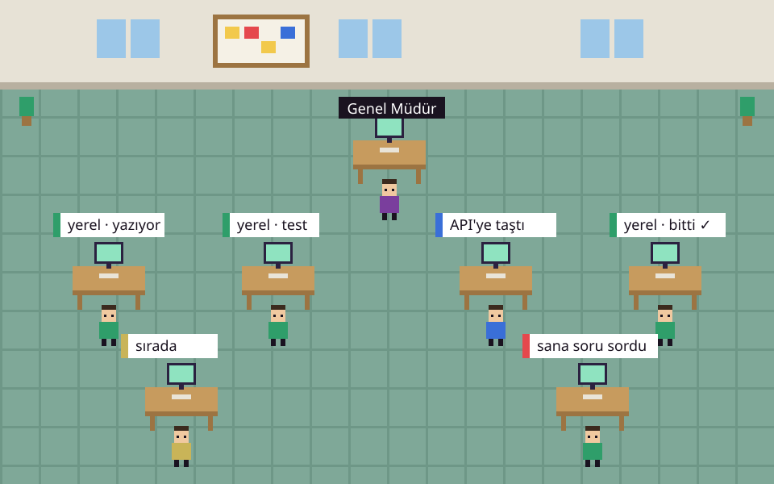

<p></p>

# Emret Agency — Installation and User Manual



Emret Agency is a desktop application that manages an office of coding agents from a single window. Each agent operates in its own terminal; the **General Manager** delegates tasks, and worker agents appear at their pixel desks while working. Agents prioritize **running on your local graphics card** with open models; when local capacity falls short, tasks overflow to free-tier cloud APIs, and finally to paid APIs.

- [Overview](#overview)
- [Key Capabilities](#key-capabilities)
- [System Requirements](#system-requirements)
- [Installation (Windows)](#installation-windows)
- [Local Model (Ollama) Setup](#local-model-ollama-setup)
- [Installation (macOS / Linux)](#installation-macos--linux)
- [First Launch & Workspace Setup](#first-launch--workspace-setup)
- [Engines: Local & Cloud APIs](#engines-local--cloud-apis)
- [Accelerating Local Models](#accelerating-local-models)
- [Interface Tour](#interface-tour)
- [Packaging as a Windows (.exe) Installer](#packaging-as-a-windows-exe-installer)
- [Telegram Bot](#telegram-bot)
- [Troubleshooting](#troubleshooting)
- [Frequently Asked Questions](#frequently-asked-questions)

---

## Overview

Working with a single coding agent is like managing one contractor: you give instructions and wait until completion. Emret Agency turns it into an autonomous engineering department:

- **General Manager** (Orchestrator) parses user requirements into engineering epics and assigns tasks.
- **Workers** (Developer, Designer, Copywriter, Researcher...) work within their own isolated git worktrees, communicate with peers, and submit pull requests.
- You converse with the General Manager in **Command Center**, review approvals in **Ask Me**, and merge completed features in **Review Desk**.

**Primary goal:** Zero token costs, local GPU computation, and 24/7 autonomous teamwork.

---

## Key Capabilities

| Domain | Description |
| --- | --- |
| **Multi-Agent Orchestration** | Claude Code, OpenCode, Codex, Crush, pi, and external CLI agents working in the same hub. |
| **Local Model Priority** | Runs on your GPU via llama-server or Ollama; zero token fees and no API keys required. |
| **Slot Cache Memory** | Agent context state is persisted to disk; resuming a 51k-token conversation takes ~2s instead of ~30s. |
| **Failover Order** | Local &rarr; Free Cloud APIs &rarr; Paid Cloud APIs &rarr; Loop back to Local if offline. |
| **Quota Guard (60% / 40%)** | Workers halt Claude usage when 5-hour/weekly limits hit 60%, reserving 40% for the General Manager. |
| **Checkpoints** | Agents save short `devam.md` notes to resume smoothly without re-evaluating prompt history. |
| **Ask Me** | Clarification questions and risky command confirmations grouped in one inbox with red badge counters. |
| **Review Desk** | Visual git branch diffs, automated test runners, and one-click branch merge/revert. |
| **Multi-Project Workspaces** | Host multiple client projects within isolated profiles, tracking tasks and costs independently. |
| **Telegram Bot** | Live status, morning briefing summaries, and urgent approval alerts sent directly to your phone. |
| **Customizer** | Retro themes, light/dark mode, brand logo upload, and drag-and-drop desk rearrangement. |

---

## System Requirements

| Component | Minimum | Recommended |
| --- | --- | --- |
| **Operating System** | Windows 10/11, macOS 13+, Ubuntu 22.04+ | Windows 11 (64-bit) |
| **Memory (RAM)** | 16 GB | 32–64 GB (for slot cache RAM caching) |
| **GPU (for local models)** | 8 GB NVIDIA VRAM | 10–24 GB NVIDIA VRAM (RTX 3080 or better) |
| **Disk Space** | 30 GB available | Fast NVMe SSD |
| **Software** | Node.js 20+, Git | + Python 3.12, VS C++ Build Tools |

---

## Installation (Windows)

1. **Clone the repository:**
   ```bash
   git clone https://github.com/emret-agency/emret-agency.git
   cd emret-agency
   ```

2. **Run the automated setup script:**
   - **With local model (Ollama):**
     ```bash
     kurulum.cmd -Yerel
     ```
   - **Cloud APIs only (no local model):**
     ```bash
     kurulum.cmd
     ```

3. **Launch the application:**
   ```bash
   baslat.cmd
   ```
   *(Keep the console window open while the application runs.)*

---

## Local Model (Ollama) Setup

For complete step-by-step instructions, see the dedicated **[Ollama Setup Guide](OLLAMA-SETUP.md)**.

Hardware compatibility matrix:
| NVIDIA VRAM | Model | Description |
| --- | --- | --- |
| Under 6 GB | — | Use cloud API engines |
| 8 GB | `emrettc-hafif` (Qwen 4B) | Light tasks, fast responses |
| 10–16 GB | `emrettc-genel` (Gemma 4 12B) | **Recommended:** All daily coding & office work |
| 24 GB+ | `emrettc-kod` (30B) / `emrettc-analiz` (27B) | Heavy code generation & deep architecture |

---

## Installation (macOS / Linux)

```bash
git clone https://github.com/emret-agency/emret-agency.git
cd emret-agency
npm install          # Automatically rebuilds node-pty for Electron
npm run dev
```

Prerequisites: macOS requires Xcode Command Line Tools (`xcode-select --install`). Linux requires `build-essential` and `python3`.

---

## First Launch & Workspace Setup

1. **Select Workspace Folder:** On first boot, designate an empty folder on your drive (e.g. `C:\Users\<user>\MyAgency`). The application stores agent state, task boards, and memories (`hive/`) here.
2. **Configure AI Engines:** Navigate to **Settings › AI Engines**.
   - Input your API keys for Google Gemini, OpenAI, Claude, Moonshot Kimi, or NVIDIA NIM.
   - Click **Test Connection** on each provider card to pull active models.
   - Keys are encrypted locally using OS keychain (`Electron safeStorage` / Windows DPAPI).
3. **Dispatch Your First Task:** Open Command Center &rsaquo; Chat and tell the General Manager what project to build.

---

## Packaging as a Windows (.exe) Installer

To distribute the application as a standalone installer for end users who do not have Node.js or Python installed:

```bash
npm run dist:win
```

The resulting setup installer will be generated in the `dist/` directory.

---

## Telegram Bot

Go to **Settings › Integrations › Telegram**. Paste your bot token from @BotFather and link your personal chat with **Pair**. Use `/status`, `/summary`, and `/help` commands from your phone to supervise your office remotely.

---

## License

MIT License. See [LICENSE](../LICENSE).

